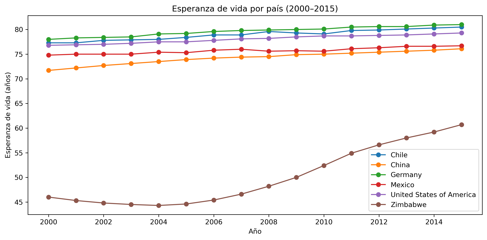
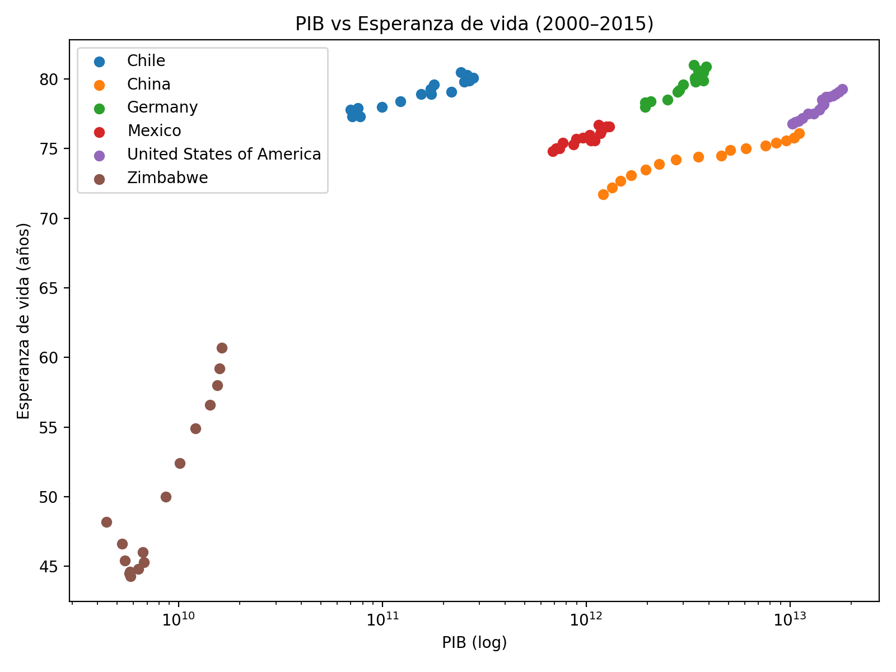

# Relación entre PIB y Esperanza de Vida (2000–2015)

Este proyecto analiza la relación entre **Producto Bruto Interno (PIB)** y **esperanza de vida** en seis países con contextos muy distintos: **Chile, China, Alemania, México, Estados Unidos y Zimbabwe**, durante el período **2000–2015**.

El objetivo es identificar tendencias, comparar comportamientos y evaluar la correlación entre crecimiento económico y longevidad.

## 📂 Estructura del proyecto

```text
├── data/                # Datos en bruto y procesados
├── notebooks/           # Notebooks de análisis paso a paso
│   ├── 00_load_data.ipynb
│   ├── 05_eda.ipynb
│   └── 06_conclusions.ipynb
├── reports/
│   └── figures/         # Gráficos generados
├── src/                 # Scripts de utilidad
└── README.md            # Este archivo

## 📊 Datos

- **Cobertura temporal:** 2000–2015  
- **Observaciones:** 96 (16 años × 6 países)  
- **Variables:**  
  - `Country`: país  
  - `Year`: año  
  - `LifeExpectancy`: esperanza de vida al nacer (años)  
  - `GDP`: Producto Bruto Interno (USD corrientes)  

## 🔍 Metodología

1. **Exploración de datos (EDA):** estadísticas descriptivas y visualizaciones.  
2. **Tendencias temporales:** evolución de PIB y esperanza de vida.  
3. **Dispersión PIB vs Esperanza de Vida:** relación entre ambas variables.  
4. **Correlaciones (Pearson y Spearman):** fuerza y dirección de la relación.  
5. **Índices base 2000:** comparación relativa de crecimiento en cada país.  

## 📈 Principales hallazgos

- **Esperanza de vida:**  
  - Creció de forma estable en todos los países salvo **Zimbabwe**, que sufrió una caída entre 2000–2004 y luego una fuerte recuperación.  
  - Alemania, Chile y EE.UU. se mantuvieron en niveles altos (>77 años promedio).  
  - China mostró un crecimiento constante desde valores más bajos hacia niveles medios-altos.  

- **PIB:**  
  - Creció suavemente en la mayoría de los países.  
  - **China** tuvo un crecimiento explosivo (más de 9 veces entre 2000 y 2015).  
  - **Zimbabwe** experimentó una caída prolongada hasta 2008, seguida de una recuperación moderada.  

- **Relación PIB–esperanza de vida:**  
  - En casi todos los países es **positiva y lineal**.  
  - **Zimbabwe** es el caso atípico: primero relación negativa, luego positiva.  

- **Correlaciones:**  
  - Muy altas en todos los casos (r > 0.90).  
  - Destacan EE.UU. (r=0.98) y Chile (r=0.95) como las más lineales.  

## 📊 Visualizaciones clave

### Tendencias de esperanza de vida


### Tendencias del PIB (índice base 2000)


### Relación PIB vs Esperanza de Vida


## ✅ Conclusiones

- El crecimiento económico suele asociarse con **mejoras en salud y longevidad**.  
- **China** ejemplifica cómo un fuerte crecimiento del PIB puede traducirse en un aumento sostenido de la esperanza de vida en poco tiempo.  
- **Zimbabwe** muestra que crisis sociales y sanitarias pueden interrumpir la relación positiva entre economía y salud.  
- La correlación entre PIB y esperanza de vida es **muy fuerte en todos los países analizados**.  

## 🚀 Próximos pasos

- Extender el análisis a más países y períodos históricos.  
- Incluir variables adicionales (gasto en salud, educación, desigualdad).  
- Aplicar modelos econométricos para cuantificar mejor la relación PIB–esperanza de vida.  

## 🛠️ Cómo reproducir el análisis

1. Clonar el repositorio:  
   ```bash
   git clone <url-del-repo>
   cd gdp_life_expectancy_project
Instalar dependencias:

bash
Copiar código
pip install -r requirements.txt
Ejecutar los notebooks:

bash
Copiar código
jupyter notebook

✍️ Autor: Simón Chiabo
📌 Proyecto de portafolio – Ciencia de Datos / Análisis Económico